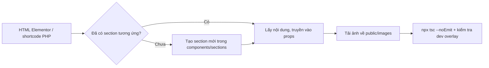

# HomeNest.media

Website giới thiệu dịch vụ của **HomeNest.media**, gồm Branding, thiết kế, SEO và Digital Marketing. Dự án đang chuyển giao diện từ WordPress/Elementor sang **Next.js App Router**.

> [!IMPORTANT]
> Dự án dùng **Next.js 16**. Phiên bản này có nhiều thay đổi phá vỡ tương thích so với các phiên bản trước. Trước khi dùng một API mới, hãy đọc tài liệu đi kèm trong `node_modules/next/dist/docs/` (xem [AGENTS.md](./AGENTS.md)).

## Công nghệ

| Hạng mục        | Công nghệ                                                          |
| --------------- | ------------------------------------------------------------------ |
| Framework       | Next.js `16.4.3` (App Router, Turbopack)                           |
| UI              | React `19.3.0`, TypeScript `5`                                     |
| Style           | CSS Modules (chủ yếu), Tailwind CSS `4` (chỉ dùng trong `globals.css` và layout) |
| Slider          | Swiper `14`                                                        |
| Font            | `HomeNest` (local, `--font-homenest`), `Manrope`, `Anton`, `Geist Mono` |

## Bắt đầu

```bash
npm install
npm run dev        # http://localhost:3000
```

| Lệnh                 | Mục đích                                  |
| -------------------- | ----------------------------------------- |
| `npm run dev`        | Chạy môi trường phát triển                |
| `npm run build`      | Build production                          |
| `npm run start`      | Chạy bản build                            |
| `npm run lint`       | Kiểm tra ESLint                           |
| `npx tsc --noEmit`   | Kiểm tra kiểu TypeScript (chạy sau mỗi lần đổi props) |

---

## Cấu trúc thư mục

```
.
├── app/                              # Routing (App Router)
│   ├── layout.tsx                    # Root layout: font, Header, FooterCTA, Footer
│   ├── globals.css                   # CSS toàn cục, .container, .fullWidth, breakpoint
│   ├── page.tsx                      # Trang chủ "/"
│   └── dich-vu/                      # Các trang dịch vụ "/dich-vu/<slug>"
│       ├── seo-tong-the/
│       ├── seo-tu-khoa/
│       ├── thiet-ke-logo-chuyen-nghiep/
│       ├── thiet-ke-nhan-dien-thuong-hieu/
│       ├── thiet-ke-mascot-linh-vat-thuong-hieu/
│       ├── thiet-ke-an-pham-marketing/
│       └── thiet-ke-profile-catalogue/
│           ├── page.tsx
│           └── page.module.css       # (tùy chọn) style riêng của trang
│
├── components/
│   ├── layout/                       # Header, Footer, FooterCTA, ScrollTopButton
│   ├── sections/
│   │   ├── common/                   # Section dùng ở nhiều loại trang (FAQ, CTA, Accompany)
│   │   └── services/                 # Section dùng cho trang dịch vụ (Service*)
│   ├── shared/                       # Component dùng chung có CSS đi kèm
│   └── ui/                           # Thành phần nhỏ: Buttons, Text, icons, Swiper, Tag
│
├── styles/                           # CSS Module, cấu trúc song song với components/
│   ├── layout/
│   ├── sections/common/
│   ├── sections/services/
│   └── ui/
│
├── constants/                        # Dữ liệu tĩnh dùng chung (SNAKE_CASE)
├── types/                            # Kiểu dữ liệu dùng chung (*.types.ts)
├── utils/                            # Hàm thuần (cn.ts, ...)
└── public/
    ├── fonts/HomeNest/
    └── images/<ten-trang-hoac-section>/  # Ảnh tĩnh, mỗi trang/section một thư mục
```

### Vai trò từng thư mục

| Thư mục                       | Mục đích                                                  | Ghi chú                                                     |
| ----------------------------- | --------------------------------------------------------- | ----------------------------------------------------------- |
| `app/`                        | Định nghĩa route và ghép các section thành trang          | Chỉ truyền nội dung qua props, không viết logic phức tạp    |
| `components/sections/`        | Các khối giao diện lớn của trang                          | Mỗi section có dữ liệu mặc định `DEFAULT_*`                 |
| `components/ui/`              | Thành phần nhỏ, dùng lại nhiều nơi                        | Không import từ `sections/`                                 |
| `styles/`                     | CSS Module cho `components/`                              | Đường dẫn khớp với `components/`                            |
| `constants/`                  | Dữ liệu tĩnh dùng chung (menu, dự án, FAQ, đối tác, ...)  | Tên viết theo `SNAKE_CASE`                                  |
| `types/`                      | Kiểu dữ liệu dùng chung                                   | Type chỉ dùng trong một component thì khai báo ngay trong component đó |
| `utils/`                      | Hàm thuần, không phụ thuộc React                          | Ví dụ: `cn.ts`                                              |
| `public/images/`              | Ảnh tĩnh, truy cập qua `/images/...`                      | Tải ảnh từ site cũ về đây, không hotlink                    |

---

## Quy trình xây dựng một trang dịch vụ

Mỗi trang dịch vụ được ghép từ các section có sẵn trong `components/sections/`. Nội dung (chữ, ảnh, bảng giá, FAQ, ...) lấy từ HTML của trang WordPress cũ rồi truyền vào section qua props.



### Bước 1: Tạo route

Tạo file `app/dich-vu/<slug>/page.tsx`, với slug theo `kebab-case` và giống URL của site cũ:

```tsx
import { CTASection, FAQSection } from "@/components/sections";
import {
    ServiceHero,
    ServiceOverview,
    ServiceStrategy,
    ServicePriceTable,
    ServiceBenefits,
    ServiceHowWeWork,
    ServiceTestimonials,
} from "@/components/sections/services";
import { TextGradient } from "@/components/ui/Text";

export default function Page() {
    return (
        <>
            <ServiceHero heading="..." description={<>...</>} ctaText="..." />
            <ServiceOverview title="..." description="..." />
            {/* ... các section khác ... */}
            <FAQSection items={[/* ... */]} />
            <ServiceTestimonials />
        </>
    );
}
```

### Bước 2: Ghép section theo thứ tự trên trang cũ

Thứ tự thường dùng:

1. `ServiceHero`: tiêu đề, mô tả, nút CTA
2. `ServiceOverview`: khi nào doanh nghiệp cần dịch vụ này
3. `ServiceStrategy`: 4 giải pháp chính
4. `ServiceLogoShowcase` / `SwiperImage` / `ServiceExperience`: trưng bày sản phẩm và năng lực
5. `ServicePriceTable`: bảng giá
6. `CTASection`
7. `ServiceProject`: dự án đã thực hiện
8. `ServiceBenefits`: lộ trình / quy trình đánh số
9. `ServiceHowWeWork`: các bước phối hợp với khách hàng
10. `FAQSection`
11. `ServiceTestimonials`

### Bước 3: Chuyển nội dung từ HTML sang props

| Thành phần trong HTML Elementor                           | Đưa vào                                          |
| --------------------------------------------------------- | ------------------------------------------------ |
| `neuros-heading` (phần `<del>` là chữ gradient)            | `heading`, dùng `<TextGradient text="..." />` cho phần gradient |
| Danh sách `elementor-icon-box` có số `01`, `02`, ...       | `ServiceBenefits` → `items: { title, desc }[]`   |
| Timeline `hn-qt__row` (badge + tiêu đề + mô tả)            | `ServiceHowWeWork` → `items: { tag, title, desc }[]` |
| Swiper bảng giá `bang-gia-container`                       | `ServicePriceTable` → `items: PricePlanItem[]`   |
| `elementor-accordion`                                      | `FAQSection` → `items: { question, answer }[]`   |
| Shortcode `[experience_expertise]` (`.ee`)                  | `ServiceExperience` → `items: ExperienceItem[]`  |

Khi chuyển nội dung:

- Bỏ toàn bộ class và thuộc tính của Elementor (`elementor-*`, `data-*`, style inline), chỉ giữ chữ, link và ảnh.
- Đổi `&amp;` thành `&` khi đặt trong chuỗi JS.
- Chỉ dùng JSX (`<>...</>`) khi nội dung có link, `<strong>`, danh sách hoặc nhiều đoạn. Nếu chỉ là chữ thường thì truyền chuỗi.
- Bỏ link tự động của plugin (`wpil_keyword_link`), trừ khi nội dung thật sự cần link đó.

### Bước 4: Xử lý hình ảnh

1. Tải ảnh từ `https://homenest.media/wp-content/uploads/...` về `public/images/<ten-trang-hoac-section>/`.
2. Tham chiếu bằng đường dẫn tuyệt đối từ `public`, ví dụ `"/images/service-experience/1-1.webp"`.
3. Dùng `next/image` (`<Image />`) và luôn khai báo `width`/`height`, hoặc dùng `fill` kèm `sizes`.

```powershell
# Ví dụ tải ảnh hàng loạt (PowerShell)
New-Item -ItemType Directory -Force -Path "public/images/<thu-muc>" | Out-Null
Invoke-WebRequest -Uri "<url-anh>" -OutFile "public/images/<thu-muc>/<ten-file>.webp"
```

### Bước 5: Kiểm tra

- Chạy `npx tsc --noEmit`, không được còn lỗi.
- Mở trang trong `npm run dev` và kiểm tra overlay lỗi của Next.js, đặc biệt là lỗi **key** và **hydration** (xem [Lỗi thường gặp](#lỗi-thường-gặp)).
- Kiểm tra giao diện ở các breakpoint `1200`, `996`, `768`, `576`, `425`.

---

## Danh sách section có sẵn

Tất cả được export từ `@/components/sections/services` hoặc `@/components/sections`.

| Section               | Props chính                                                                    | Kiểu phần tử của `items`                         |
| --------------------- | ------------------------------------------------------------------------------ | ------------------------------------------------ |
| `ServiceHero`         | `heading`, `description`, `ctaText`, `ctaLink?`                                | –                                                |
| `ServiceOverview`     | `title`, `description`, `urlImg?`, `altImg?`                                   | –                                                |
| `ServiceStrategy`     | `heading`, `title1..4`, `desc1..4`                                             | –                                                |
| `ServiceLogoShowcase` | `title?`, `heading?`, `descriptionDefault?`, `items?`, `ctaText?`              | `{ color, bien2: { image, desc }[] }`            |
| `ServiceExperience`   | `heading?`, `items?`, `autoplay?` (ms, mặc định `6000`)                        | `{ num?, title, desc, image?, bg?, card?, thumb? }` |
| `ServicePriceTable`   | `heading?`, `items?`                                                           | `{ title, imageTag?, description, features[], note?, phone?, price, ctaText? }` |
| `ServiceProject`      | `heading?`, `description?`, `items?`                                           | `Project`                                        |
| `ServiceResult`       | `heading?`, `items?`, `columns?` (mặc định `3`), `mediaSrc?`, `mediaAlt?`      | `{ label, number }`                              |
| `ServiceBenefits`     | `heading?`, `imageSrc?`, `imageAlt?`, `items?`, `ctaText?`, `ctaLink?`         | `{ number?, title, desc }`                       |
| `ServiceHowWeWork`    | `heading?`, `items?`, `showCta?`, `ctaText?`, `ctaLink?`                       | `{ number?, tag?, title, desc? }`                |
| `ServiceReview`       | `heading?`, `items?`, `statNumber?`, `statLabel?`, `backgroundSrc?`            | `{ quote, author }`                              |
| `ServiceWhyTrust`     | `heading?`, `imageSrc?`, `items?`                                              | `{ title, desc }`                                |
| `ServiceTestimonials` | `items?`                                                                       | `{ avatar, name, job, quote }`                   |
| `FAQSection`          | `items?`, `headingText?`                                                       | `{ question, answer }`                           |
| `CTASection`          | `heading?`, `description?`, `ctaText?`, `ctaHref?`, `imageSrc?`                | –                                                |
| `AccompanySection`    | `items?`, `quoteHighlight?`, `quoteSuffix?`, `duplicateCount?`                 | `Partner`                                        |
| `SwiperImage` (ui)    | `items`, `aspectRatio?`, `speed?`, `loop?`                                     | `string \| { src, alt? }`                        |

> Nếu một prop có giá trị mặc định (`DEFAULT_*` hoặc từ `constants/`), bỏ trống prop đó thì section hiển thị nội dung mặc định.

---

## Quy trình tạo section mới

Khi trang cũ có một khối chưa có section tương ứng (ví dụ một shortcode PHP riêng):

1. **Tạo component** `components/sections/services/ServiceXxx.tsx`
   - Khai báo `export type XxxItem = {...}` cho phần tử dữ liệu.
   - Khai báo `export const DEFAULT_XXX_ITEMS: XxxItem[] = [...]` làm dữ liệu mặc định.
   - Khai báo `export type ServiceXxxProps = {...}`. Prop nhận mảng **luôn đặt tên là `items`**.
   - Chỉ thêm `"use client"` khi cần `useState`, `useEffect`, event handler hoặc API của trình duyệt.
2. **Tạo CSS** `styles/sections/services/ServiceXxx.module.css`
   - Bọc nội dung giữa `/* Start - Service Xxx */` và `/* End - Service Xxx */`.
   - Tên class viết `camelCase`. Class trạng thái dùng `isActive`, `isClickable`, ...
   - Chuyển CSS gốc sang: bỏ tiền tố BEM (`.ee__title` → `.title`) và bỏ `!important` nếu chỉ dùng để thắng CSS của theme cũ.
3. **Chuyển JS sang React**: `classList.toggle` thành state, `setInterval` thành `useEffect` có cleanup, `querySelectorAll` thành `ref` hoặc render theo mảng.
4. **Export** trong `components/sections/services/index.ts`:

   ```ts
   export { default as ServiceXxx, DEFAULT_XXX_ITEMS } from "./ServiceXxx";
   export type { ServiceXxxProps, XxxItem } from "./ServiceXxx";
   ```

5. Import từ `@/components/sections/services` để dùng trong trang.

---

## Quy ước code

### Props

- Prop nhận **mảng dữ liệu** luôn đặt tên là `items` (không dùng `plans`, `faqs`, `benefits`, `images`, ...).
- Prop chứa nội dung có định dạng dùng kiểu `ReactNode`, và truyền bằng **ngoặc tròn**:

  ```tsx
  // Đúng
  description={(<>Nội dung có <a href="...">link</a></>)}

  // Sai: tạo ra mảng không có key → lỗi "Each child in a list should have a unique key"
  description={[<>Nội dung có <a href="...">link</a></>]}
  ```

- Tách dữ liệu dài ra hằng số đầu file (`const SEO_KEYWORD_PRICE_PLANS: PricePlanItem[] = [...]`) khi muốn file trang dễ đọc hơn.

### CSS Module

- **Không để class rỗng** (`.abc {}`). Turbopack bỏ class rỗng ở phía client, nên `className` lệch giữa server và client và gây lỗi hydration. Nếu chưa có style thì đừng gắn class đó vào JSX.
- Dùng `.container` (có giới hạn chiều rộng) hoặc `.fullWidth` (tràn màn hình) từ `globals.css` làm khung ngoài của section.
- Ghép className bằng `[styles.x, className].filter(Boolean).join(" ")` hoặc `cn()` trong `utils/cn.ts`.

### HTML / JSX

- Không lồng thẻ khối vào `<p>`. Nếu nội dung truyền vào có thể chứa `<p>` hoặc `<ul>`, thẻ bọc ngoài phải là `<div>`.
- Mọi phần tử render từ `.map()` phải có `key`.
- Ảnh dùng `next/image`. Chỉ dùng `` khi bắt buộc (ví dụ ảnh nền chuyển cảnh liên tục trong `ServiceExperience`).

### Đặt tên

| Đối tượng           | Quy tắc               | Ví dụ                                  |
| ------------------- | --------------------- | -------------------------------------- |
| Thư mục route       | `kebab-case`          | `app/dich-vu/thiet-ke-logo-chuyen-nghiep/` |
| File component      | `PascalCase.tsx`      | `ServicePriceTable.tsx`                |
| CSS Module          | `TenComponent.module.css` | `ServicePriceTable.module.css`     |
| File type           | `camelCase.types.ts`  | `logoShowcase.types.ts`                |
| Hằng số             | `SNAKE_CASE`          | `DEFAULT_BENEFITS`, `PROJECTS`         |
| Type phần tử        | `XxxItem`             | `BenefitItem`, `PricePlanItem`         |
| Type props          | `ComponentNameProps`  | `ServiceBenefitsProps`                 |
| Thư mục ảnh         | `kebab-case`          | `public/images/service-experience/`    |

### Import

Dùng alias `@/` thay cho đường dẫn tương đối dài, theo thứ tự:

1. Thư viện ngoài (`react`, `next/...`, `swiper/...`)
2. Alias nội bộ (`@/components`, `@/constants`, `@/types`, ...)
3. Đường dẫn tương đối (`./`, `../`)
4. File style (`.css`, `.module.css`)

### Server Component và Client Component

- Mặc định mọi component là **Server Component**.
- Chỉ thêm `"use client"` cho component cần state, effect, event handler hoặc API của trình duyệt (ví dụ: `ServiceExperience`, `ServiceHowWeWork`, `ServiceLogoShowcase`, `FAQSection`).
- File `page.tsx` giữ là Server Component và chỉ ghép section.

---

## Lỗi thường gặp

| Thông báo lỗi                                                  | Nguyên nhân                                                    | Cách sửa                                                  |
| -------------------------------------------------------------- | -------------------------------------------------------------- | --------------------------------------------------------- |
| `Each child in a list should have a unique "key" prop`         | Truyền prop dạng `={[ <>...</> ]}` hoặc `.map()` thiếu `key`   | Đổi `[ ]` thành `( )`, hoặc thêm `key`                    |
| `A tree hydrated but some attributes ... didn't match` (`className`) | Gắn class CSS Module rỗng vào JSX                        | Xóa class rỗng trong CSS và trong JSX                     |
| `In HTML, <p> cannot be a descendant of <p>`                   | Truyền `<p>` vào component có thẻ bọc là `<p>`                 | Đổi thẻ bọc trong component thành `<div>`                 |
| `Invalid src prop ... hostname is not configured`              | Dùng URL ảnh ngoài với `next/image`                            | Tải ảnh về `public/images/`                               |
| TypeScript báo prop không tồn tại sau khi đổi tên              | Còn chỗ gọi dùng tên prop cũ                                   | Tìm toàn dự án và cập nhật, rồi chạy lại `npx tsc --noEmit` |

---

## Quy định Breakpoint (Responsive)

### Container mặc định

| Thuộc tính          | Giá trị  |
| ------------------- | -------- |
| `max-width`         | `1400px` |
| `padding` hai bên   | `40px`   |

### Các breakpoint

| Media query                | `max-width` container | `padding` hai bên     |
| -------------------------- | --------------------- | --------------------- |
| `@media (min-width: 2000px)` | `1600px`              | `40px` (giữ mặc định) |
| `@media (max-width: 1600px)` | `1400px` (giữ mặc định) | `40px` (giữ mặc định) |
| `@media (max-width: 1400px)` | giữ mặc định          | `40px` (giữ mặc định) |
| `@media (max-width: 1200px)` | giữ mặc định          | `32px`                |
| `@media (max-width: 996px)`  | giữ mặc định          | `28px`                |
| `@media (max-width: 768px)`  | giữ mặc định          | `24px`                |
| `@media (max-width: 576px)`  | giữ mặc định          | `20px`                |
| `@media (max-width: 425px)`  | giữ mặc định          | `16px`                |

> Các breakpoint `1600px` và `1400px` không thay đổi `padding` hay `max-width`, giữ nguyên giá trị đang áp dụng.

### Ví dụ CSS

```css
.container {
  max-width: 1440px;
  margin-inline: auto;
  padding-inline: 40px;
}

.fullWidth {
  width: 100%;
  max-width: none;
}

@media (min-width: 2000px) {
  .container { max-width: 1600px; }
}

@media (max-width: 1600px) {}

@media (max-width: 1400px) {}

@media (max-width: 1200px) {
  .container { padding-inline: 32px; }
}

@media (max-width: 996px) {
  .container { padding-inline: 28px; }
}

@media (max-width: 768px) {
  .container { padding-inline: 24px; }
}

@media (max-width: 576px) {
  .container { padding-inline: 20px; }
}

@media (max-width: 425px) {
  .container { padding-inline: 16px; }
}
```

Khi viết media query trong CSS Module của section, dùng đúng các mốc trên. Riêng các section chuyển từ code cũ có thể giữ mốc gốc (ví dụ `991px`, `480px` trong `ServiceExperience`).

---

## Checklist trước khi commit

- [ ] `npx tsc --noEmit` không báo lỗi
- [ ] `npm run lint` không báo lỗi mới
- [ ] Overlay lỗi của Next.js trên trang vừa sửa không còn lỗi `key` hay hydration
- [ ] Ảnh mới đã nằm trong `public/images/` và không còn URL `homenest.media/wp-content`
- [ ] Prop mảng đặt tên `items`, prop `ReactNode` truyền bằng `( )`
- [ ] Không có class CSS rỗng
- [ ] Section mới đã được export trong `index.ts`
- [ ] Đã kiểm tra giao diện ở các breakpoint chính

## Tài liệu tham khảo

- [Next.js Documentation](https://nextjs.org/docs)
- Tài liệu Next.js đi kèm phiên bản đang dùng: `node_modules/next/dist/docs/`
- [Swiper React](https://swiperjs.com/react)
